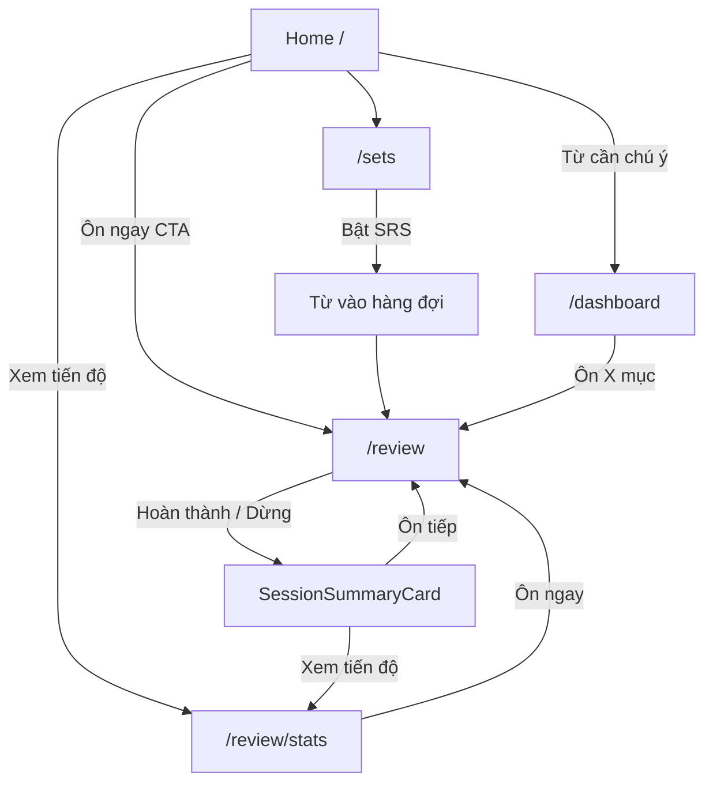

# Stitch Design Brief — Dashboard & SRS Review (Mobile-first)

> **Mục đích:** Tài liệu này dành cho Google Stitch thiết kế lại **Dashboard tiến bộ** (`/dashboard`, `/review/stats`) và **giao diện SRS ôn tập** (`/review`) cho app **Learn Chinese** — ưu tiên trải nghiệm mobile.
>
> **Ngôn ngữ UI:** Tiếng Việt. Brand terms giữ tiếng Anh: *Learn Chinese*, *Vocabulary Mastery*, *SRS*.

---

## 1. Tóm tắt sản phẩm & trải nghiệm mong muốn

### App là gì?

**Learn Chinese** (*Học Hán Ngữ*) giúp người Việt học từ vựng tiếng Trung giản thể. Luồng học chính:

1. **Tạo bộ từ** sau buổi học (dán danh sách từ, import Excel, hoặc HSK)
2. **Bật SRS** trên bộ từ → từ được đưa vào hàng đợi ôn lặp ngắt quãng
3. **Luyện tập** (practice) — không ảnh hưởng SRS, chỉ ghi log
4. **Ôn SRS** (review) — cập nhật lịch ôn thật, 3 kênh kỹ năng mỗi từ
5. **Xem tiến độ** — dashboard & thống kê SRS

### Persona người dùng

- Sinh viên / người đi làm Việt Nam, học tiếng Trung trên lớp
- Dùng **điện thoại** để ôn 5–15 phút mỗi ngày (trên xe, giữa giờ)
- Muốn biết: *"Hôm nay còn bao nhiêu mục?"*, *"Tôi đang yếu kênh nào?"*, *"Bộ từ này tiến độ ra sao?"*
- Không thích UI game hóa (không streak neon, không mascot)

### Cảm xúc thương hiệu — Ink & Vermillion

| Token | Giá trị | Ý nghĩa |
|-------|---------|---------|
| Background | `#f7f4ef` | Giấy rice paper ấm |
| Surface | `#fffcf8` | Card gần trắng |
| Foreground | `#1c1410` | Mực ấm |
| Primary / Accent | `#c41e3a` | Đỏ son (con dấu) — CTA duy nhất mỗi màn |
| Success | `#2d6a4f` | Đúng, đã thuộc |
| Warning | `#b45309` | Yếu, trễ hạn |
| Gold | `#b8860b` | Thành tựu (dùng ít) |

**Typography:** Source Sans 3 (UI) + Noto Sans SC (chữ Hán — luôn là visual hero trên màn học).

**Depth:** Tonal layering + border 1px `#ddd2c4`. **Không** drop shadow, glassmorphism, gradient.

Chi tiết đầy đủ: [`DESIGN.md`](../DESIGN.md)

---

## 2. Mô hình dữ liệu SRS (Stitch PHẢI hiểu trước khi thiết kế số liệu)

### Đơn vị đếm: "mục" = 1 từ × 1 kênh

Mỗi từ có **3 kênh kỹ năng đang hoạt động:**

| Kênh | Tiếng Việt | Icon gợi ý |
|------|------------|------------|
| `meaning` | Nghĩa | `translate` |
| `sound` | Âm đọc | `headphones` |
| `sentence` | Dùng câu | `text_fields` |

### Trạng thái từ (aggregate, theo từ)

| State | Nhãn UI | Màu |
|-------|---------|-----|
| `new` | Mới | gray |
| `learning` | Đang học | accent subtle |
| `familiar` | Quen | blue tint |
| `strong` | Vững | success |
| `mastered` | Đã nhớ chắc | gold |
| `weak` | Yếu | warning |

### Giai đoạn SRS mỗi kênh (theo interval index)

```
MCQ1 (idx 0) → MCQ2 (idx 1) → Recall gõ lại (idx 2) → Maintain (idx 3–5: 7/14/30 ngày)
```

### Hai trục độc lập — KHÔNG trộn lẫn trên UI

| Trục | Ý nghĩa | Ví dụ metric |
|------|---------|--------------|
| **Lịch ôn** | Kênh nào đến hạn *bây giờ* | `dueToday`, `dueTotal`, `overdueCount` |
| **Chất lượng nhớ** | Từ yếu / đang học theo lịch sử | `weakCount`, `stateDistribution` |

Một từ có thể **yếu nhưng chưa đến hạn**, hoặc **đến hạn nhưng không yếu**. UI phải giải thích rõ hoặc đặt ở section khác nhau.

### Bộ từ & SRS

- Mỗi bộ từ có toggle **Ôn SRS** (`srsActive`)
- Chỉ từ trong bộ **SRS active** mới vào hàng đợi `/review`
- Tiến độ bộ từ = % kênh **không đến hạn hôm nay** (KHÔNG phải % đã mastered)

---

## 3. Rà soát logic — lỗi & gap hiện tại (Stitch thiết kế phải sửa UX)

Đây là các vấn đề **đã xác nhận trong code** — thiết kế mới cần khắc phục bằng nhãn/copy/bố cục đúng, không chỉ làm đẹp.

| # | Vấn đề | Hiện trạng code | Hướng thiết kế đúng |
|---|--------|-----------------|---------------------|
| G1 | Kênh "Dùng câu" | Kênh câu đang có trong hàng đợi ôn khi từ có câu điền được | Hiện như kênh hoạt động, cùng Nghĩa và Âm đọc |
| G2 | Progress bar bộ từ sai nghĩa | Home: `masteredChannels = max - dueCount` → nhãn "Tiến độ" gây hiểu nhầm là mastered | Đổi nhãn: **"Kênh ổn định"** hoặc **"X/Y kênh không đến hạn"** |
| G3 | Đếm bộ từ sai | `setCount` = tất cả bộ, kể cả SRS tắt; label "Bộ từ đang học" | Đổi label **"Tổng bộ từ"** hoặc tách "Bộ SRS active" |
| G4 | Forecast lệch dueToday | Forecast tính từ mọi progress row; `dueToday` chỉ SRS-active | Ghi chú footer: *"Dự báo theo từ đã có tiến độ"* hoặc scope badge |
| G5 | weakCount vs dueToday | Hai metric khác nhau nhưng cùng grid stat | Tách section: **"Hôm nay"** vs **"Sức khỏe trí nhớ"** |
| G6 | Tiến độ phiên ôn mờ | Có `SessionProgressDots` + chip `~N` còn lại nhưng nhỏ, không có "12/30" rõ | Thêm **thanh tiến độ hôm nay** nổi bật: `đã ôn / tổng ước tính` |
| G7 | Nhãn kênh ôn nhỏ | `ChannelPill` 10px góc phải — dễ bỏ qua trên mobile | Đưa pill kênh **dưới prompt** hoặc trên hero card, size lớn hơn |
| G8 | Dashboard vs Review Stats trùng | `/dashboard` và `/review/stats` gần giống nhau, user không biết vào đâu | Gộp hoặc phân vai rõ: Home hero → Stats chi tiết → Dashboard lỗi chuyên sâu |
| G9 | Review full-screen thiếu context | `/review` ẩn bottom nav (focus mode) — tốt, nhưng không có link nhanh về stats | Thêm icon `query_stats` trong header hoặc sau summary |

---

## 4. File code cần gửi Stitch đọc

Gửi **file brief này** + các file dưới đây để Stitch hiểu data contract và UI hiện tại.

### Bắt buộc — Design system

| File | Vì sao |
|------|--------|
| [`DESIGN.md`](../DESIGN.md) | Tokens, typography, brand, layout shell |
| [`docs/google-stitch/STITCH-ADDITIONAL-INSTRUCTIONS.txt`](./google-stitch/STITCH-ADDITIONAL-INSTRUCTIONS.txt) | Instruction chung đã dùng trước đó |

### Bắt buộc — Data & business logic

| File | Vì sao |
|------|--------|
| [`src/types/chinese.ts`](../src/types/chinese.ts) | `CnDashboardDTO`, `CnReviewStatsDTO`, `CnPracticeQuestionDTO` |
| [`src/config/constants.ts`](../src/config/constants.ts) | SRS intervals, prefetch size, thresholds |
| [`src/services/chinese/cnSrsService.ts`](../src/services/chinese/cnSrsService.ts) | Engine SRS: due, submit, priority |
| [`src/services/chinese/cnDashboardService.ts`](../src/services/chinese/cnDashboardService.ts) | Metrics dashboard |
| [`src/services/chinese/cnReviewStatsService.ts`](../src/services/chinese/cnReviewStatsService.ts) | Metrics review stats (phong phú hơn dashboard) |
| [`src/services/chinese/cnSetService.ts`](../src/services/chinese/cnSetService.ts) | Bộ từ, dueCount/weakCount per set |
| [`src/lib/chinese/setSrsProgress.ts`](../src/lib/chinese/setSrsProgress.ts) | Công thức progress bar bộ từ |
| [`src/lib/chinese/reviewMetrics.ts`](../src/lib/chinese/reviewMetrics.ts) | Forecast, streak, state distribution |
| [`src/lib/chinese/practiceTaxonomy.ts`](../src/lib/chinese/practiceTaxonomy.ts) | 3 kênh, question types |

### Bắt buộc — UI hiện tại (screens cần redesign)

| File | Màn hình |
|------|----------|
| [`src/app/(app)/page.tsx`](../src/app/(app)/page.tsx) | Home — mobile hero SRS |
| [`src/app/(app)/dashboard/page.tsx`](../src/app/(app)/dashboard/page.tsx) | Dashboard lỗi & tiến bộ |
| [`src/app/(app)/review/stats/ReviewStatsClient.tsx`](../src/app/(app)/review/stats/ReviewStatsClient.tsx) | Trạng thái học SRS |
| [`src/app/(app)/review/ReviewSessionClient.tsx`](../src/app/(app)/review/ReviewSessionClient.tsx) | Phiên ôn SRS |
| [`src/components/chinese/QuestionRenderer.tsx`](../src/components/chinese/QuestionRenderer.tsx) | Card câu hỏi + progress dots |
| [`src/components/chinese/SessionSummaryCard.tsx`](../src/components/chinese/SessionSummaryCard.tsx) | Kết thúc phiên |
| [`src/components/chinese/ForecastBars.tsx`](../src/components/chinese/ForecastBars.tsx) | Biểu đồ 7 ngày |
| [`src/components/chinese/StateDistributionBar.tsx`](../src/components/chinese/StateDistributionBar.tsx) | Phân bổ trình độ |
| [`src/components/chinese/ActivityHeatmap.tsx`](../src/components/chinese/ActivityHeatmap.tsx) | Heatmap đà học |
| [`src/components/layout/AppShell.tsx`](../src/components/layout/AppShell.tsx) | Focus mode ẩn nav khi `/review` |
| [`src/components/layout/BottomNavBar.tsx`](../src/components/layout/BottomNavBar.tsx) | Bottom nav mobile |

### Tham khảo thêm

| File | Vì sao |
|------|--------|
| [`src/app/(app)/sets/[id]/page.tsx`](../src/app/(app)/sets/[id]/page.tsx) | Set detail + SRS toggle |
| [`src/components/chinese/SrsVocabManager.tsx`](../src/components/chinese/SrsVocabManager.tsx) | Modal quản lý từ SRS |
| [`docs/google-stitch/SCREENS.md`](./google-stitch/SCREENS.md) | Inventory màn hình toàn app |

---

## 5. Data contract — nhãn UI chính xác cho từng field

### `CnDashboardDTO` (`GET /api/dashboard`)

```typescript
interface CnDashboardDTO {
  setCount: number;           // → "Tổng bộ từ" (KHÔNG phải "đang học")
  wordsLearned: number;       // → "Từ đã học" (state ≠ new)
  wordsMastered: number;      // → "Đã nhớ chắc" (state = mastered)
  weakCount: number;          // → "Cần chú ý" (weak + learning) — KHÔNG = due
  dueToday: number;           // → "Cần ôn hôm nay" — chỉ SRS-active, 3 kênh
  overdueCount: number;       // → sub-label "X trễ" màu warning
  forecast: ForecastDay[];    // → 7 ngày, mỗi cột = số mục đến hạn
  stateDistribution: {...};   // → stacked bar: new/learning/familiar/strong/mastered/weak
  maturePct: number;          // → % strong + mastered
  streak: number;             // → "X ngày liên tiếp" (chỉ từ review logs)
  overallRate: number;        // → "Tỷ lệ đúng" — practice + review, 500 log gần nhất
  meaningRate: number;        // → kênh Nghĩa %
  soundRate: number;          // → kênh Âm đọc %
  sentenceRate: number;       // → kênh Dùng câu %
  topErrors: ErrorCount[];    // → "Lỗi phổ biến"
  weakWords: WordBrief[];     // → chip link → /words/[id]
  suggestions: string[];      // → card "Đề xuất"
}
```

### `CnReviewStatsDTO` (`GET /api/review/stats`) — phong phú hơn, nên là màn SRS chính

```typescript
interface CnReviewStatsDTO {
  dueTotal: number;           // mục còn cần ôn (≈ dueToday, có thể giảm trong phiên)
  overdueCount: number;
  reviewedToday: number;        // đã ôn hôm nay
  correctToday: number;
  accuracyToday: number;        // % đúng hôm nay
  remainingEstimate: number;
  weakCount: number;
  meaningRate / soundRate / sentenceRate: number;  // 3 kênh: nghĩa, âm đọc, câu
  recallAccuracy / mcqAccuracy: number;  // breakdown theo loại câu
  streak / bestStreak: number;
  avgPerDay7 / avgPerDay30: number;
  maturePct: number;
  stateDistribution: {...};
  forecast: ForecastDay[];
  dailySeries: ActivityDay[];   // cho heatmap
  nextDueAt / nextDueLabel: string | null;  // khi hết việc hôm nay
  insights: string[];         // gợi ý tự động — hiển thị banner
  hasActiveWords: boolean;      // empty state khi false
  weakWords / topErrors: [...];
  recentSessions: SessionSummary[];  // 7 ngày gần nhất
}
```

### Set card (Home / Sets list)

```typescript
// Per set from listUserSets:
{
  title: string;
  itemCount: number;      // số từ
  srsActive: boolean;
  dueCount: number;     // số KÊNH đến hạn (không phải số từ)
  weakCount: number;    // số TỪ weak/learning trong bộ
}

// Progress bar:
maxChannels = itemCount × 3
stableChannels = maxChannels - dueCount   // NHÃN: "kênh ổn định", KHÔNG "mastered"
progressPct = (1 - dueCount/maxChannels) × 100
```

---

## 6. Luồng UX tổng thể



### Phân vai màn hình sau redesign (đề xuất)

| Màn | Vai trò | Đối tượng |
|-----|---------|-----------|
| **Home mobile hero** | CTA ôn hôm nay + 3 ngày forecast mini | Hành động hàng ngày |
| **`/review/stats`** | SRS hub chính: hôm nay, streak, heatmap, forecast | Theo dõi tiến độ |
| **`/dashboard`** | Phân tích sâu: lỗi, kênh yếu, từ cần chú ý | Tự cải thiện |
| **`/review`** | Focus session — zero distraction | Ôn thực tế |

---

## 7. Màn hình cần thiết kế — chi tiết

### 7.1 Home — Mobile SRS Hero (`/` — section `md:hidden`)

**Mục tiêu:** Mở app → biết ngay phải làm gì trong 2 giây.

**Layout (mobile only, full-width card):**

```
┌─────────────────────────────────────┐
│ HỌC TIẾNG TRUNG                     │
│                                     │
│  24          [3 trễ]                │  ← số lớn accent, badge warning
│  mục cần ôn hôm nay                 │
│                                     │
│  Hôm nay 24 · Mai 18 · CN 12        │  ← mini forecast 3 ngày
│                                     │
│              [ ▶ Ôn ngay ]          │  ← btn-primary, pill, bên phải
│                                     │
│  📊 Xem tiến độ ôn tập →            │  ← link /review/stats
└─────────────────────────────────────┘
```

**Empty state** (`dueToday === 0`):
- Số `0` màu muted, không đỏ
- CTA đổi thành **"Chọn bộ từ"** → `/sets`
- Subcopy: *"Bật Ôn SRS trên bộ từ để bắt đầu"*

**States:**
- Có overdue → badge vàng `X trễ` cạnh số
- Streak > 0 → chip nhỏ dưới hero (optional, không chiếm spotlight)

---

### 7.2 SRS Stats — Trạng thái học (`/review/stats`) — **MÀN CHÍNH MOBILE**

**Mục tiêu:** Trả lời *"Hôm nay học thế nào? Tuần này sao? Kênh nào yếu?"*

**Header:**
```
SRS
Trạng thái học
Báo cáo ôn tập · 1 mục = 1 từ × 1 kênh
```

**Insight banners** (nếu `insights.length > 0`):
- Card accent-subtle, 1–2 dòng, ví dụ: *"Kênh nghe đang yếu — thử luyện nghe 5 phút"*

**Primary CTA row:**
```
[ ▶ Ôn ngay ]    Còn ~24 mục · 3 đang trễ    🔥 5 ngày
```

**Section A — Hôm nay (hero card):**
```
┌─────────────────────────────────────┐
│ HÔM NAY                             │
│ 8 đã ôn · ~16 còn lại               │
│ ████████░░░░░░░░  33%               │  ← progress bar accent
│ Mục tiêu nhẹ — không bắt buộc hết   │
└─────────────────────────────────────┘
```

**Section B — Stat grid 2×2 (mobile):**
| Cần ôn | Đã ôn hôm nay |
| Đúng hôm nay % | Cần chú ý |

**Section C — Dự báo 7 ngày:**
- `ForecastBars` component — cột theo ngày
- Footer: *"Vàng = đang trễ"*
- Tap cột → tooltip số mục (design interaction)

**Section D — Đà học** (chỉ khi có activity):
- 3 stat nhỏ: Streak / TB 7 ngày / TB 30 ngày
- `ActivityHeatmap` — 12 tuần, ô vuông nhỏ

**Section E — Sức khỏe trí nhớ:**
- `StateDistributionBar` stacked
- Legend: đã thuộc (strong+mastered) | đang học | yếu
- `maturePct` badge

**Section F — Tỷ lệ theo kênh (CHỈ 3 kênh):**
```
Nghĩa      ████████░░  78%
Âm đọc     █████░░░░░  52%   ← highlight nếu < 60%
Dùng câu   ███████░░░  71%
```

**Section G — Cần chú ý + Lỗi phổ biến:**
- Chip từ (hanzi) → tap mở word card
- List lỗi + count

**Section H — Phiên gần đây:**
- Row: *"Hôm nay 14:32 · 12 câu · 83% đúng"*

**Empty state** (`!hasActiveWords`):
```
📖 Bắt đầu theo dõi tiến độ
Bật Ôn SRS trên một bộ từ...
[ Chọn bộ từ ]
```

---

### 7.3 Dashboard lỗi & tiến bộ (`/dashboard`)

**Mục tiêu:** Phân tích lỗi & điểm yếu — **không trùng** với `/review/stats`.

**Định vị lại:** *"Dashboard lỗi"* — tập trung diagnostic, không phải daily driver.

**Header:**
```
TIẾN BỘ
Dashboard lỗi & điểm yếu
[🔥 5 ngày]                    [Ôn 24 mục] ← mobile only
```

**Stat grid — nhóm theo ý nghĩa:**

*Hàng 1 — Phạm vi học:*
- Tổng bộ từ | Từ đã học | Đã nhớ chắc

*Hàng 2 — Hôm nay & chất lượng:*
- Cần ôn hôm nay (+ X trễ) | Cần chú ý | Tỷ lệ đúng tổng

**Sections (thứ tự ưu tiên mobile):**
1. Lỗi phổ biến (expandable trên mobile — mặc định mở 3 lỗi đầu)
2. Tỷ lệ theo kênh (3 kênh)
3. Từ cần chú ý (chip)
4. Phân bổ trình độ (collapsed by default trên mobile)
5. Lịch ôn 7 ngày (collapsed)
6. Đề xuất (card cuối)

**Khác biệt với `/review/stats`:**
- Không có heatmap, không có "đã ôn hôm nay"
- Có `topErrors` và `suggestions` nổi bật hơn
- `overallRate` bao gồm cả practice

---

### 7.4 SRS Review Session (`/review`) — **FOCUS MODE MOBILE**

**Shell:** Ẩn bottom nav + top bar (`AppShell` focus mode). Full viewport cho câu hỏi.

#### Phase: Loading
- Skeleton card giữa màn
- Nút "Quản lí từ vựng SRS" góc phải (secondary)

#### Phase: Empty — không có mục
```
        🎉
Không có mục cần ôn hôm nay.
Bật Ôn SRS trên bộ từ...

[ Xem tiến độ ]  [ Chọn bộ từ ]
```

#### Phase: Review — câu hỏi (CORE)

**Header bar (sticky top):**
```
[✕ Dừng]          ✓8  ✗2  ~14  [NGHE]  [≡]
                   ↑ chips    ↑ channel pill lớn hơn hiện tại
```

**Progress bar (mới — nổi bật hơn dots hiện tại):**
```
Đã ôn 10 · Còn ~20          33%
████████████████░░░░░░░░░░░░
```
- Dots segment (xanh/amber/xám) giữ lại NHƯNG thêm label số rõ ràng phía trên

**Channel indicator (redesign G7):**
- Pill kênh đặt **ngay dưới header**, full-width centered:
```
┌─────────────────────────────────┐
│  🎧  KÊNH NGHE · MCQ            │
└─────────────────────────────────┘
```
- Màu theo kênh: Nghĩa=accent, Nghe=success, Pinyin=neutral

**Question card (center):**
```
        Nghe và chọn nghĩa đúng

            折磨
           zhé mó

        [ 🔊 Phát lại ]

   ┌─────┐ ┌─────┐
   │ A   │ │ B   │    ← tap targets min 48px
   └─────┘ └─────┘
   ┌─────┐ ┌─────┐
   │ C   │ │ D   │
   └─────┘ └─────┘
```

**Feedback state:**
- Đúng: border success, text *"Đúng!"*, schedule label *"Ôn lại sau 3 ngày"*
- Sai: border warning, *"Sai — đáp án: làm khổ"*, nút **Tiếp** full-width

**Sticking point** (`isStickingPoint`): banner nhỏ warning trên card

#### Phase: Summary
```
        ✓
      Ôn xong!
    18 / 22  ·  82% đúng

Còn khoảng 6 mục cần ôn

[ Ôn tiếp ]  [ Xem tiến độ ]  [ Trang chủ ]
```

#### SrsVocabManager modal
- Bottom sheet trên mobile (không center modal)
- List từ SRS-active, toggle mark known / remove

---

### 7.5 Set card trên Home (progress fix G2)

**Hiện tại (sai):**
```
Tiến độ          45 / 60
████████░░░░  75%
```

**Thiết kế đúng:**
```
Kênh ổn định     45 / 60        ← hoặc "Không đến hạn"
████████░░░░  75%
3 kênh cần ôn · 2 từ yếu        ← metadata row
```

Badge trạng thái bộ:
- SRS tắt → badge "Chưa bật SRS", progress bar ẩn
- SRS bật + due > 0 → badge "Có việc hôm nay" accent
- SRS bật + due = 0 → badge "Vững vàng" success

---

## 8. Mobile navigation & layout shell

### Bottom nav (5 items) — visible trừ `/review` và `/practice`

| Tab | Icon | Route |
|-----|------|-------|
| Trang chủ | `home` | `/` |
| Bộ từ | `menu_book` | `/sets` |
| Ôn tập | `replay` | `/review` — badge số due |
| Tiến độ | `query_stats` | `/review/stats` |

> **Lưu ý:** `/dashboard` không cần tab riêng — truy cập từ Home hoặc link trong Stats.

### Breakpoints

| | Mobile | Desktop |
|---|--------|---------|
| Stat grid | 2 cột | 4 cột |
| Channel rates | 1 cột stack | 2 cột |
| Review question | full width, max 672px centered | same |
| Sidebar | hidden | 240px fixed |

---

## 9. Component patterns (tái sử dụng)

| Component | Mô tả visual |
|-----------|--------------|
| `card-paper` | bg-surface, border 1px border, rounded-xl (12px), p-4 |
| `btn-primary` | bg accent, text white, rounded-full, label-caps |
| `btn-secondary` | transparent, border, rounded-full |
| `label-caps` | 12px bold uppercase tracking-widest text-muted |
| `Stat tile` | icon accent + label-caps + số 3xl font-black |
| `Channel pill` | rounded-full, icon + label, màu theo kênh |
| `ProgressBar` | h-2 rounded-full, track surface-hover |
| `ForecastBars` | cột bar 7 ngày, hôm nay highlight accent |
| `StateDistributionBar` | stacked horizontal, 6 màu state |
| `Word chip` | rounded-full, border accent/30, hanzi bold |

---

## 10. Instruction gửi Google Stitch

Copy block dưới đây vào prompt Stitch (kèm file đính kèm ở mục 4):

---

```
Thiết kế UI mobile-first cho 4 màn hình của app "Learn Chinese" (Ink & Vermillion design system):

1. Home mobile SRS hero (section đầu trang chủ)
2. /review/stats — "Trạng thái học" (SRS hub chính trên mobile)
3. /dashboard — "Dashboard lỗi & điểm yếu" (phân tích diagnostic)
4. /review — phiên ôn SRS focus mode (loading, empty, question, summary)

ĐỌC TRƯỚC:
- DESIGN.md (design tokens)
- docs/stitch-design-brief.md (file này — data contract + UX gaps)

YÊU CẦU BẮT BUỘC:
- UI tiếng Việt; brand terms giữ English
- Mobile portrait 390×844 là canvas chính; thêm desktop variant
- Warm cream paper (#f7f4ef), vermillion accent (#c41e3a), flat borders — NO shadows
- Chinese characters (Noto Sans SC) là visual hero trên màn ôn
- 1 primary CTA vermillion mỗi màn
- Đơn vị "mục" = 1 từ × 1 kênh (3 kênh: Nghĩa, Nghe, Pinyin)
- KHÔNG hiển thị kênh "Dùng câu" như active
- Sửa nhãn progress bộ từ: "Kênh ổn định" thay vì "Tiến độ/mastered"
- Tách rõ metric "Cần ôn hôm nay" (lịch) vs "Cần chú ý" (chất lượng)
- Review session: progress bar rõ "đã ôn / còn lại", channel pill lớn và nổi bật
- Bottom nav 5 tab; ẩn nav khi đang ôn (/review)
- Empty states thân thiện, 1 CTA, không illustration nặng
- Light mode default + dark mode variant (warm dark #0f0e0d)

DELIVERABLES:
- High-fidelity mockups: 4 màn × (mobile + desktop where relevant)
- Component specs: stat tile, channel pill, progress bar, forecast bars, question card
- All interactive states: empty, loading, in-progress, feedback correct/wrong, summary
- Annotation layer: giải thích từng số liệu hiển thị

THAM CHIẾU UX (không copy visual):
- Anki (SRS clarity)
- Duolingo (session flow only — KHÔNG copy màu/neon)
- Calm editorial layouts

KHÔNG:
- Pure white background
- Multiple accent colors
- Gamification mascots / confetti
- English navigation labels
- Drop shadows / glassmorphism
```

---

## 11. Checklist sau khi Stitch trả design

Dev team implement theo design mới cần:

- [ ] Sửa label Home set card (`setSrsProgress` + copy)
- [ ] Bỏ hoặc disable `sentenceRate` trên dashboard/stats UI
- [ ] Thêm `reviewedToday` progress vào Review session header (data đã có ở stats API, cần wire vào session)
- [ ] Phân vai rõ link Home → `/review/stats` vs `/dashboard`
- [ ] Channel pill redesign trong `QuestionRenderer`
- [ ] Optional backend: filter dashboard metrics theo SRS-active words (fix G4)

---

*Tài liệu tạo: 2026-06-23 · Phiên bản 1.0*
